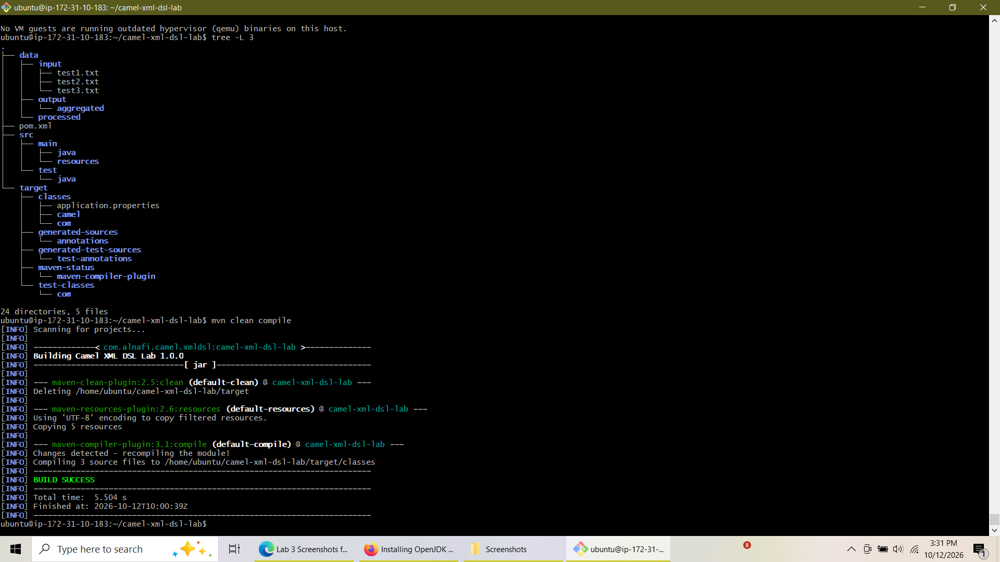
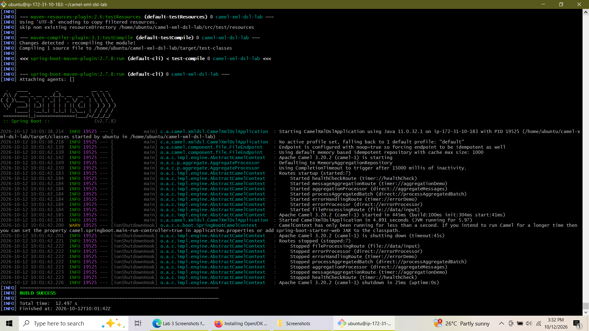
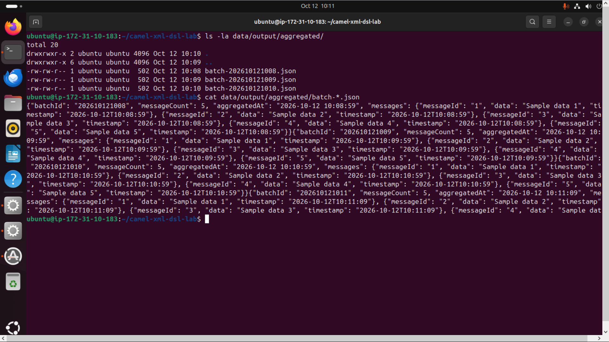

# Apache Camel XML DSL & Enterprise Integration Patterns Lab

[](https://www.oracle.com/java/)
[](https://spring.io/projects/spring-boot)
[](https://camel.apache.org/)
[](https://maven.apache.org/)
[](https://ubuntu.com/)

A production-ready Enterprise Application Integration (EAI) project demonstrating file routing, message aggregation, content-based routing, error handling via Dead Letter Channel (DLC), and route monitoring using **Apache Camel (XML DSL)** and **Spring Boot**.

## 🛠️ Tech Stack & Key Technologies

* **Language:** Java 11
* **Framework:** Spring Boot 2.7.8
* **Integration Engine:** Apache Camel 3.20.2 (XML DSL)
* **Build Tool:** Apache Maven
* **Enterprise Integration Patterns (EIP):**
  * Content-Based Router
  * Aggregator Pattern
  * Splitter Pattern
  * Dead Letter Channel (DLC)
  * File Poller & Message Filter

## 📁 Project Architecture & Directory Structure

```text
camel-xml-dsl-lab/
├── pom.xml
├── data/
│   ├── input/                # Incoming source files
│   └── output/               # Processed & Aggregated JSON batch destinations
│       └── aggregated/
└── src/
    ├── main/
    │   ├── java/com/alnafi/camel/xmldsl/
    │   │   ├── CamelXmlDslApplication.java   # Spring Boot Entry Point
    │   │   └── MyAggregationStrategy.java    # Custom Camel Aggregation Strategy
    │   └── resources/
    │       ├── application.properties        # Camel & Spring Configuration
    │       └── camel/                        # XML DSL Route Definitions
    │           ├── file-processing-route.xml
    │           ├── content-based-router.xml
    │           ├── aggregation-route.xml
    │           ├── error-handling-route.xml
    │           └── health-check-route.xml
    └── test/
        └── java/com/alnafi/camel/xmldsl/
            └── XmlDslRouteTest.java          # Automated Route Unit Tests
```

## 🚀 Key Features & Implemented Routes

### 1. Message Aggregation (`aggregation-route.xml`)
* **Trigger:** Scheduled timer fires JSON payload batches.
* **Pattern:** Uses `split()` and custom `MyAggregationStrategy` to group messages into dynamic batch JSON files based on size (`completionSize=5`) or idle timeout (`completionTimeout=15s`).
* **Destination:** Writes aggregated output to `data/output/aggregated/batch-${header.BatchId}.json`.

### 2. Content-Based Routing (`content-based-router.xml`)
* Filters incoming message streams and dynamically directs traffic to specific tier channels (`Premium`, `Standard`, and `Basic`) based on message header evaluating logic.

### 3. Fault Tolerance & Error Handling (`error-handling-route.xml`)
* Configures `deadLetterChannel` with retry parameters (redelivery attempts & delay).
* Handles `java.io.IOException` scenarios and logs failures gracefully to error sinks without interrupting pipeline execution.

### 4. Health Check & JMX Monitoring (`health-check-route.xml`)
* Exposes periodic status pings to verify route availability and context runtime stability.

## 🚦 Getting Started

### Prerequisites
* Java JDK 11 or higher
* Apache Maven 3.6+

### Build & Compilation
Clone the repository and compile the project using Maven:
```bash
git clone https://github.com/YOUR_USERNAME/camel-xml-dsl-lab.git
cd camel-xml-dsl-lab
mvn clean compile
```

### Running the Application
Execute the Spring Boot Camel Application:
```bash
mvn spring-boot:run
```

To run automated unit tests:
```bash
mvn clean test
```

### 1. Project Structure and Clean Build
Verifies project layout via `tree -L 3` and successful compilation with `mvn clean compile`.


### 2. Application Startup & Route Loading
Confirms Spring Boot initialization and Apache Camel route deployment.


### 3. Aggregated Batch Output Verification
Displays generated `batch-*.json` files and content inspection confirming successful message aggregation.


## 📜 Conclusion
In this project, we have:

* Created XML DSL routes using Apache Camel's declarative configuration approach
* Implemented content-based routing with conditional logic and message transformation
* Configured error handling with dead letter channels and retry policies
* Built message aggregation patterns to combine multiple messages into batches
* Added monitoring and health checks to ensure route reliability
* Tested routes using both manual testing and automated unit tests

