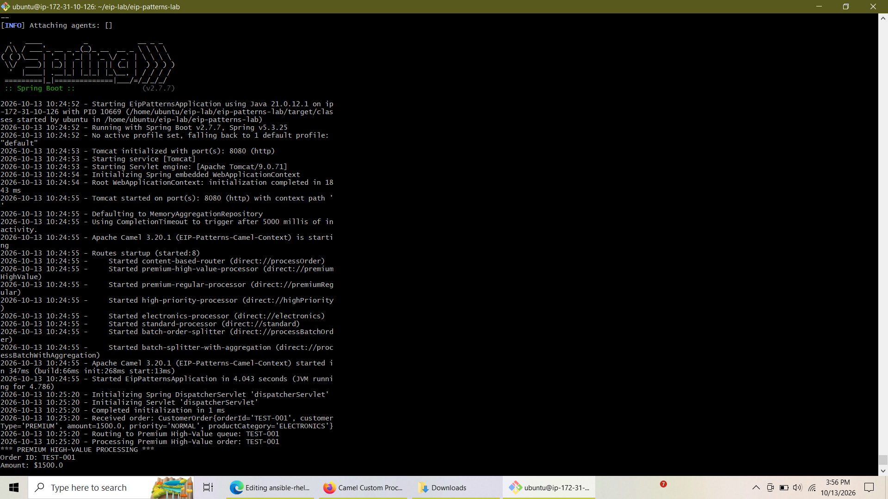
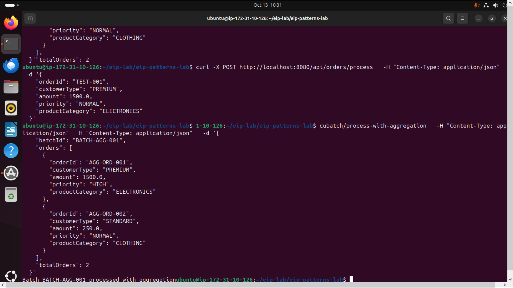

# Lab 5: Implementing Enterprise Integration Patterns (EIPs) using Apache Camel and Spring Boot

[](https://openjdk.org/)
[](https://spring.io/projects/spring-boot)
[](https://camel.apache.org/)
[](https://maven.apache.org/)
[](https://ubuntu.com/)

---

## 📌 Table of Contents
1. [Lab Overview](#-lab-overview)
2. [Architecture & Enterprise Integration Patterns](#-architecture--enterprise-integration-patterns)
3. [Project Structure](#-project-structure)
4. [Application Startup & Initialization](#-application-startup--initialization)
5. [Testing Guide & Pattern Execution](#-testing-guide--pattern-execution)
6. [Conclusion](#-conclusion)

---

## 📌 Lab Overview

This laboratory focuses on designing and implementing core **Enterprise Integration Patterns (EIPs)** using **Apache Camel** integrated inside a **Spring Boot** microservices foundation. Running on an Ubuntu cloud environment, the application exposes RESTful controllers that ingest complex order payloads, utilizing Camel routing topologies to dynamically inspect, route, break down (split), and reassemble (aggregate) transactional message flows.

---

## 🏗️ Architecture & Enterprise Integration Patterns

The application leverages three primary messaging and integration patterns:

1. **Content-Based Router (`choice` / `when` / `otherwise`):** 
   Inspects incoming order attributes (such as `customerType`, `amount`, and `productCategory`) and dynamically routes messages to specialized downstream processor queues (e.g., Premium High-Value, High Priority, Electronics, or Standard queues).
2. **Splitter Pattern (`split`):** 
   Deconstructs high-volume `BatchOrder` payloads containing multiple line items into individual streamable `CustomerOrder` messages for granular, isolated processing.
3. **Aggregator Pattern (`aggregate`):** 
   Collects separate individual messages resulting from a split operation, merges their states using a custom `AggregationStrategy`, and emits a unified compiled response.

---

## 📁 Project Structure

```text
eip-patterns-lab/
├── images/
│   ├── app-startup.png
│   └── splitter-aggregator.png
├── src/
│   ├── main/java/com/alnafi/eip/
│   │   ├── controller/
│   │   │   ├── OrderController.java
│   │   │   └── BatchController.java
│   │   ├── model/
│   │   │   ├── CustomerOrder.java
│   │   │   └── BatchOrder.java
│   │   ├── routes/
│   │   │   ├── ContentBasedRouterRoute.java
│   │   │   └── SplitterRoute.java
│   │   └── EipPatternsApplication.java
│   └── test/java/
├── pom.xml
└── README.md
```

---

## 🚀 Application Startup & Initialization

To initialize the integration engine and verify route configurations, the application is launched via Maven. All Camel routes load successfully during context startup without resource or port conflicts.



*As captured above, Spring Boot initializes cleanly on port `8080`, activating all 8 Camel routes (`content-based-router`, processor queues, and batch splitter/aggregator workflows).*

---

## 🧪 Testing Guide & Pattern Execution

You can test the system endpoints using `curl` requests in a separate terminal window while the application is active.

### 1. Testing Content-Based Router
This command sends a high-value premium order that matches the primary routing rule:
```bash
curl -X POST http://localhost:8080/api/orders/process \
  -H "Content-Type: application/json" \
  -d '{
    "orderId": "TEST-001",
    "customerType": "PREMIUM",
    "amount": 1500.0,
    "priority": "NORMAL",
    "productCategory": "ELECTRONICS"
  }'
```

### 2. Testing Splitter & Aggregator Execution
This command submits a batch order containing multiple items, triggering the split mechanism and subsequent aggregation flow:
```bash
curl -X POST http://localhost:8080/api/batch/process-with-aggregation \
  -H "Content-Type: application/json" \
  -d '{
    "batchId": "BATCH-AGG-001",
    "orders": [
      {
        "orderId": "AGG-ORD-001",
        "customerType": "PREMIUM",
        "amount": 1500.0,
        "priority": "HIGH",
        "productCategory": "ELECTRONICS"
      },
      {
        "orderId": "AGG-ORD-002",
        "customerType": "STANDARD",
        "amount": 250.0,
        "priority": "NORMAL",
        "productCategory": "CLOTHING"
      }
    ],
    "totalOrders": 2
  }'
```



*The execution terminal demonstrates the incoming batch request being ingested, split into discrete child elements, processed asynchronously, and successfully aggregated back into a cohesive response stream.*

---

## 📝 Conclusion

Lab 5 successfully demonstrates the immense power and flexibility of combining **Spring Boot** with **Apache Camel** for enterprise-grade integration challenges. By implementing **Content-Based Routing**, we decoupled order evaluation logic from core business controllers, allowing dynamic message distribution based on runtime payload headers and properties. Furthermore, utilizing the **Splitter and Aggregator** patterns enabled robust handling of bulk batch data, breaking monolithic payloads down for granular processing before securely re-assembling results. This architecture provides high maintainability, clear separation of concerns, and seamless scalability for modern distributed cloud environments.